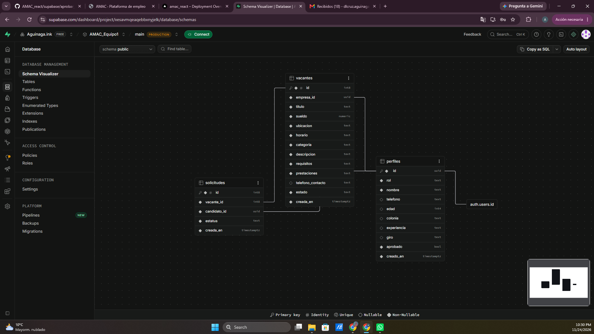

# AMAC_react
Entrega final de desarrollo de aplicaciones web

Aplicación web para AMAC para adultos mayores, empresas y administración. El frontend es una SPA en React. Los datos, el inicio de sesión y la seguridad por fila estan en Supabase. Se publica en Vercel con https.

**Sitio publicado (Vercel):** https://amacreact.vercel.app/
**Video de la presentación:** 
**Entregas anteriores:**  
- FIGMA: https://www.figma.com/design/qoXt2EuZUhMGNxdyHFwg1U
- HTML/CSS: https://github.com/al-aguinaga/amac-web

## Integrantes y qué hizo cada uno

Integrante | Archivos | Qué hizo 

Ryan Higgins | `package.json`, `package-lock.json`, `vite.config.js`, `index.html`, `.gitignore`, `.env.example`, `vercel.json`, `main.jsx`, `supabase.js`, `AuthContext.jsx`, `RutaProtegida.jsx`, `Campo.jsx`, `Aviso.jsx`, `Login.jsx`, `RegistroCandidato.jsx`, `RegistroEmpresa.jsx` | Creó el proyecto con Vite, hizo el contexto de sesión y la ruta protegida por rol, y los formularios de inicio de sesión y registro (candidato y empresa). 

Sofia De los Santos | `App.jsx`, `catalogos.js`, `Encabezado.jsx`, `Pie.jsx`, `TarjetaVacante.jsx`, `EtiquetaEstatus.jsx`, los archivos de css, `ListadoVacantes.jsx` | Definió las rutas, pasó el HTML y CSS de la Entrega 2 a componentes, e hizo el listado de vacantes con búsqueda y filtros.

David Jiménez | `DetalleVacante.jsx`, `MisSolicitudes.jsx`, `esquema.sql`, `aprobar_candidato.sql` | Diseñó la base de datos y las políticas RLS, y construyó el detalle de vacante (postularme, llamar) y Mis solicitudes (cancelar).

Alejandro Aguiñaga | `EmpresaVacantes.jsx`, `PublicarVacante.jsx`, `SolicitudesRecibidas.jsx`, `datos_ejemplo.sql`, `README.md` | Hizo el flujo de la empresa (publicar, pausar/reactivar/cerrar, cambiar estatus), cargó las vacantes de ejemplo, conectó React con Supabase, configuró el despliegue en Vercel y redactó este README. |

## Tecnologías

React - Vite - React Router - Supabase (Auth, PostgreSQL, RLS) - Vercel - CSS 

## Cómo correrlo (de forma local)

1. Instalar Node.js 
2. `npm install`
3. Configurar `VITE_SUPABASE_URL` y `VITE_SUPABASE_PUBLISHABLE_KEY` en `.env.local`.
4. Ejecutar `esquema.sql` en Supabase.
5. `npm run dev`

## Cuentas de prueba (todas tienen la misma contraseña por practicidad)

Tipo | Correo | Contraseña

Candidato aprobado | candidato.aprobado@amac-demo.com | Amac2026! 
Candidato sin aprobar | candidato.nuevo@amac-demo.com | Amac2026! 
Empresa | empresa@amac-demo.com | Amac2026! 

## Base de datos (esquema)

Tres tablas: `perfiles` (uno por usuario de Auth, con rol y `aprobado`), `vacantes` (de una empresa) y `solicitudes` (de un candidato a una vacante, con `unique (vacante_id, candidato_id)` para no aplicar dos veces). Un trigger (`crear_perfil`) crea el perfil al registrarse. El SQL completo está en la carpeta de supabase en `esquema.sql`.

### Políticas RLS

Tabla | Política | Qué hace 

perfiles | Cada quien ve su perfil | Un usuario solo lee su propia fila. 
perfiles | Todos ven los perfiles de empresas | Permite mostrar el nombre de la empresa en el listado público. 
perfiles | La empresa ve a quien aplicó a sus vacantes | La empresa lee el perfil solo de quienes se postularon con ella. 
perfiles | Cada quien edita su perfil | Solo se actualiza la fila propia, y solo columnas permitidas: nadie puede cambiar su `rol` ni `aprobado`. 

vacantes | Ver vacantes activas o las propias | El público solo ve vacantes activas; la empresa ve también las suyas pausadas o cerradas. 
vacantes | El candidato sigue viendo las vacantes a las que aplicó | Aunque se pausen (RF-021). 
vacantes | Solo empresas publican, a su nombre | Un insert solo funciona si el usuario es empresa y `empresa_id` es el suyo. 
vacantes | La empresa edita sus vacantes | Permite pausar, reactivar y cerrar solo las propias. 

solicitudes | Candidato ve las suyas; empresa ve las de sus vacantes | Cada parte solo ve lo que le corresponde. 
solicitudes | Solo candidatos aprobados se postulan | Un insert exige ser el propio candidato, estatus `Enviada` y `aprobado = true` (RF-054). 
solicitudes | Candidato cancela si no está resuelta | Solo puede pasar a `Cancelada` si está `Enviada` o `En revisión`. 
solicitudes | Empresa cambia el estatus | Solo en solicitudes de sus vacantes y solo a En revisión, Aceptada o Rechazada. 

## Requerimientos implementados

RF | Descripción | Estado 

RF-001 | Listado de vacantes activas desde la BD | Completado
RF-002, RF-007 | Búsqueda por palabra clave y filtros (horario, categoría) | Completado 
RF-003, RF-051 | Detalle de vacante y botón Llamar (solo si hay teléfono) | Completado
RF-004, RF-054 | Postularse (sin duplicar, solo aprobados) | Completado 
RF-005, RF-006 | Mis solicitudes y cancelar con confirmación | Completado
RF-008, RF-009 | Inicio y cierre de sesión | Completado
RF-010 | Rutas protegidas por rol y RLS | Completado
RF-011, RF-012, RF-013 | Registro de candidato con términos | Completado 
RF-015 | Registro de empresa (simplificado) | Completado 
RF-019 | Publicar vacante con validación | Completado 
RF-020, RF-021 | Mis vacantes, número de solicitudes, pausar/reactivar/cerrar | Completado 
RF-022, RF-024 | Solicitudes recibidas y cambio de estatus | Completado
RF-052 | Botón de ayuda / llamar en todas las páginas | Completado 
RF-054 | Aprobación de candidatos desde Supabase (manual) | Parcial 
RF-014, RF-016, RF-017, RF-029, RF-041, RF-055 | Perfiles, logo, recuperar contraseña, favoritas, etapas | Pendiente

## Seguridad

- `.env.local` no se sube a GitHub. Las llaves van como variables de entorno en Vercel.
- Solo usamos la publishable key.
- RLS está activado en las tres tablas.
- Las contraseñas las maneja solo Supabase Auth.

## Accesibilidad

Se mantienen las cosas de la Entrega 2: texto base de 18 px en `rem`, contraste alto, botones de al menos 44 px, etiquetas visibles, foco visible, enlace "Saltar al contenido", mensajes de error con texto, y diseño mobile-first de 320 a 1440 px.
